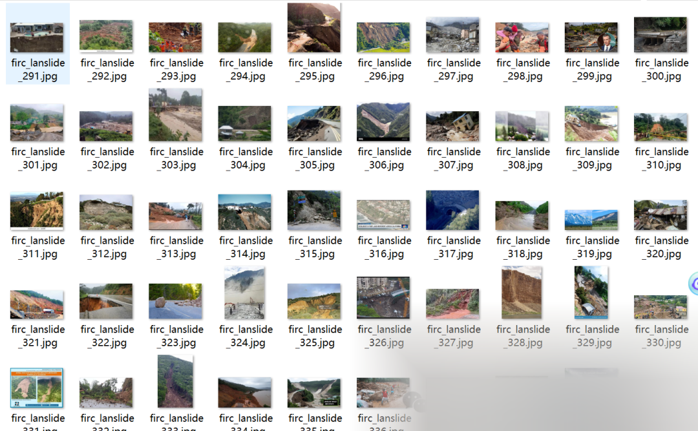
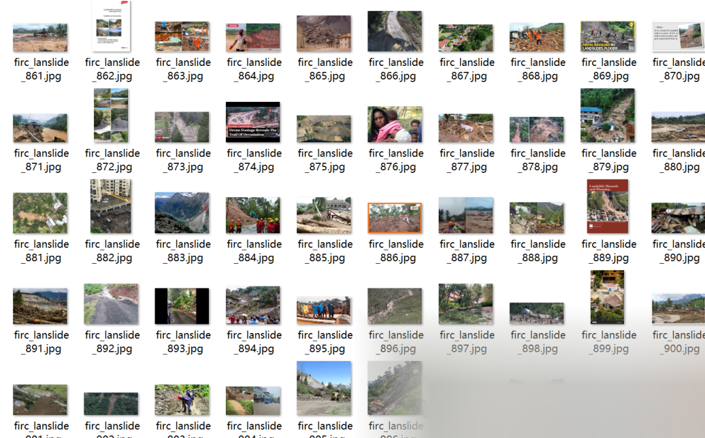
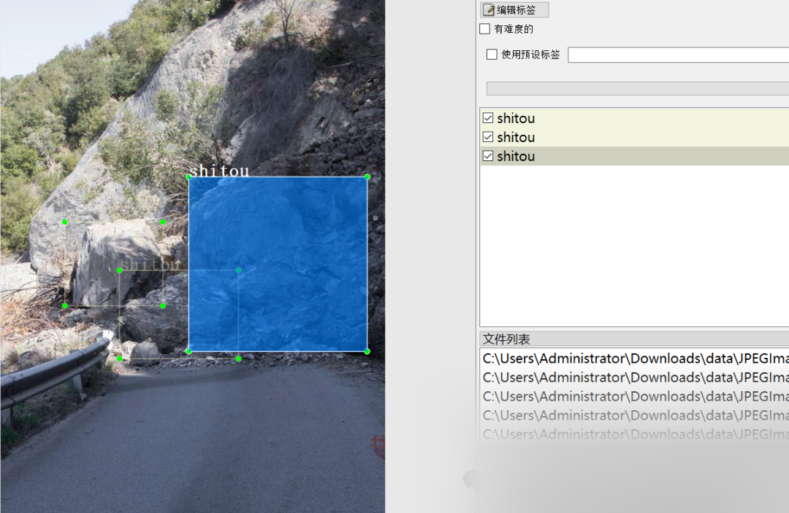

# Highway Landslide, Falling Rocks and Tree Detection Dataset VOC+YOLO format with 1485 images in 4 categories

Dataset format: Pascal VOC format + YOLO format (txt file without split path, only containing jpg images and corresponding VOC format xml files and yolo format txt files)
Number of images (number of jpg files): 1485
Number of annotations (number of xml files): 1485
Number of annotations (number of txt files): 1485
Number of annotation categories: 4
Annotation category names: ["daolutanta", "daoshu", "huapo", "shitou"]

Corresponding Chinese Name: Road Collapse, Tree Fall, Landslide, Stone
Number of boxes per category:
daolutanta = 453
daoshu = 1136
huapo = 1220
shitou = 1949
Total number of boxes = 4758
Labeling tool used: labelImg
Labeling rules: Draw a rectangle around the category.
Important Note: No guarantee is made regarding the accuracy or precision of the trained models or weight files. The dataset only provides accurate and reasonable annotations.

Image Preview:

Annotation example:

## Payment

Here is a pay link on Stripe ( https://buy.stripe.com/3cs8yP7sY87d0vu9AB ). Please contact me lonlonago@foxmail.com after funding $89, and I will send you a complete data files , thank you!

